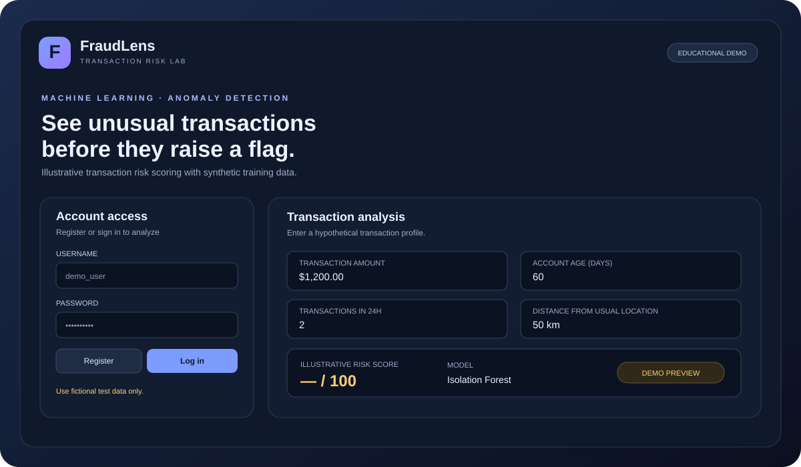
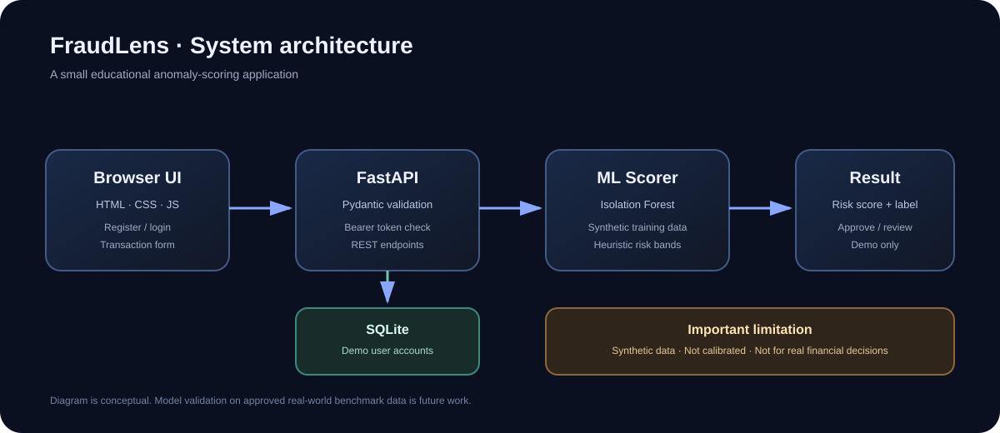

# FraudLens — Fraud Detection System

A portfolio-ready, educational transaction-anomaly detection demo built with **FastAPI, scikit-learn, SQLite, and a responsive HTML dashboard**. It includes account registration/login, protected prediction endpoints, input validation, automated tests, Docker support, API documentation, and a Render deployment blueprint.

> **Important:** This repository currently trains an Isolation Forest on **synthetic example data**. Its score is an illustrative anomaly score, **not** a calibrated probability of fraud. This is not a validated banking/financial risk system and must not be used to approve, block, or accuse real customers without appropriate data, validation, monitoring, human review, and compliance work.

## Visual preview

*Illustrative design preview, not a screenshot of a running deployment.*

## Highlights

- **Interactive dashboard:** responsive transaction form and readable risk-result panel.
- **Authentication:** register and log in; prediction requires a valid bearer token.
- **Password storage:** PBKDF2-HMAC-SHA256 password hashing with a random salt. Older demo SHA-256 hashes are upgraded on successful login.
- **ML baseline:** reproducible scikit-learn IsolationForest trained on synthetic data.
- **Risk bands:** low, medium, and high heuristic labels based on the model score.
- **Validated inputs:** Pydantic constraints reject invalid or implausible input ranges.
- **API documentation:** interactive Swagger UI at /docs, ReDoc at /redoc, and OpenAPI JSON at /openapi.json.
- **Health check:** /health.
- **Tests and CI:** authentication, protected prediction, validation, and health endpoint tests.
- **Deployment options:** Docker and Render Blueprint configuration.

## Architecture

Request flow: browser dashboard → FastAPI validation/authentication → Isolation Forest scoring → risk band and review suggestion. SQLite stores demo user accounts. The current model uses generated data and does not load a real transaction dataset.

## Technology stack

| Area | Technology |
|---|---|
| API | Python, FastAPI, Pydantic |
| ML | scikit-learn Isolation Forest, NumPy |
| Authentication | Signed bearer tokens, PBKDF2 password hashing |
| Database | SQLite |
| UI | HTML, CSS, vanilla JavaScript |
| Testing | pytest, FastAPI TestClient, HTTPX |
| Deployment | Docker, Render |

## Project structure

~~~text
fraud-detection-system/
├── api.py                    # API routes, validation, demo model and scoring
├── app/
│   ├── auth.py                # Password hashing and signed bearer tokens
│   └── db.py                  # SQLite database initialization
├── web/
│   └── index.html             # Responsive dashboard
├── tests/
│   └── test_api.py            # Health, auth, validation and prediction tests
├── docs/
│   └── images/
│       ├── architecture.svg
│       └── dashboard-preview.svg
├── .github/workflows/tests.yml
├── .env.example
├── Dockerfile
├── render.yaml
├── requirements.txt
└── README.md
~~~

## Requirements

- Python 3.12 or newer (Python 3.12 is the recommended baseline)
- Git
- Optional: Docker Desktop / Docker Engine

## Run locally

### 1. Clone the repository

~~~bash
git clone https://github.com/Mausd34/fraud-detection-system.git
cd fraud-detection-system
~~~

### 2. Create and activate a virtual environment

**Windows PowerShell**

~~~powershell
py -3.12 -m venv .venv
.\.venv\Scripts\Activate.ps1
~~~

**Windows Command Prompt**

~~~bat
py -3.12 -m venv .venv
.venv\Scripts\activate.bat
~~~

**macOS / Linux**

~~~bash
python3.12 -m venv .venv
source .venv/bin/activate
~~~

### 3. Install dependencies and set a local secret

~~~bash
python -m pip install --upgrade pip
pip install -r requirements.txt
~~~

Set a private development token secret before starting the app.

**PowerShell**

~~~powershell
$env:JWT_SECRET = "replace-with-a-long-random-local-secret"
~~~

**macOS / Linux**

~~~bash
export JWT_SECRET="replace-with-a-long-random-local-secret"
~~~

For a quick local-only run, the app has a development fallback. Never rely on that fallback for a public deployment.

### 4. Start the application

~~~bash
uvicorn api:app --reload
~~~

Open:
- Dashboard: http://127.0.0.1:8000/
- Swagger API docs: http://127.0.0.1:8000/docs
- Health: http://127.0.0.1:8000/health

### 5. Use the dashboard

1. Open the dashboard URL.
2. Register with a fictional username (3–80 letters/numbers/underscore/hyphen) and a password of at least 8 characters.
3. Log in.
4. Enter hypothetical transaction attributes.
5. Select **Analyze transaction** and review the demo score and risk band.
6. Log out when finished.

Do not enter real customer, card, account, or personally identifying information.

## API usage

### Health check

~~~bash
curl http://127.0.0.1:8000/health
~~~

### Register an account

~~~bash
curl -X POST http://127.0.0.1:8000/auth/register \
  -H "Content-Type: application/json" \
  -d '{"username":"demo_user","password":"example-password-123"}'
~~~

### Log in and capture the token

~~~bash
curl -X POST http://127.0.0.1:8000/auth/login \
  -H "Content-Type: application/json" \
  -d '{"username":"demo_user","password":"example-password-123"}'
~~~

Copy the access_token from the response and use it as TOKEN below.

### Predict a hypothetical transaction

~~~bash
curl -X POST http://127.0.0.1:8000/predict \
  -H "Content-Type: application/json" \
  -H "Authorization: Bearer TOKEN" \
  -d '{"amount":1200,"account_age_days":60,"velocity_24h":2,"distance_km":50,"foreign":false}'
~~~

The response includes risk_score, risk_level, a suggested demo action, the model identifier, and a notice that the score is not a probability. The API returns HTTP 401 if the token is missing or invalid and HTTP 422 for invalid input.

## Run tests

~~~bash
pytest -q
~~~

Tests cover the health route, authentication requirement, registration/login, current-user route, successful prediction, invalid credentials, and input validation.

## Docker

Build and run the application:

~~~bash
docker build -t fraud-detection-system .
docker run --rm -p 8000:8000 \
  -e JWT_SECRET="replace-with-a-long-random-secret" \
  fraud-detection-system
~~~

Then visit http://127.0.0.1:8000/.

The included container uses SQLite in the container filesystem. Data may not survive container replacement; use a managed database and an appropriate persistent storage strategy for a real deployment.

## Deploy to Render

This repository includes a render.yaml Blueprint for a Python web service.

1. Push the repository to GitHub.
2. Open [Render Dashboard](https://dashboard.render.com/).
3. Select **New + → Blueprint**.
4. Connect Mausd34/fraud-detection-system and select the main branch.
5. Review the service settings and environment variables.
6. Apply the Blueprint and wait for the build/deploy to finish.
7. Verify the deployed /health endpoint and open the root dashboard URL.

Render configuration uses the PORT environment variable and binds to 0.0.0.0, as required by Render's web-service runtime. See the [official FastAPI deployment guide](https://render.com/docs/deploy-fastapi).

**Free-hosting caveats:** a free service may sleep when idle, and local SQLite data is not durable across all restarts/redeploys. Do not use this setup for important or real financial data.

## How the model works

1. The demo creates a deterministic synthetic feature matrix using a fixed random seed.
2. An Isolation Forest learns a baseline of generated feature patterns.
3. A submitted transaction is converted to a numeric feature vector: amount, account age, 24-hour velocity, distance, and foreign-transaction flag.
4. The model's decision function is mapped to a bounded heuristic score from 0 to 100.
5. The score is grouped into low, medium, or high risk. Scores of 40 and above suggest review; lower scores suggest approval **only within this demo**.

The generated training data is not a substitute for a representative, labelled, legally usable transaction dataset. The score mapping is heuristic and has not been calibrated or validated on real fraud outcomes. Synthetic training and test data must not be reported as evidence of real-world fraud detection performance.

## Responsible-use and security notes

- Use fictional test data only.
- Keep JWT_SECRET private and generate a unique, long random value for any shared demo.
- This is a small educational app, not a production identity system. Before public production use, add rate limiting, account recovery, token revocation/rotation, stronger operational monitoring, secure database management, and a reviewed security model.
- Evaluate a real model using an approved dataset, chronological and leakage-resistant splits, class-imbalance-aware metrics (precision, recall, PR-AUC), calibration where relevant, subgroup/error analysis, and human review.
- A high anomaly score does not prove fraud. A low score does not prove a transaction is legitimate.

## Roadmap

- [ ] Replace synthetic data with a documented, approved benchmark dataset.
- [ ] Add a reproducible training/evaluation pipeline and model artifact versioning.
- [ ] Report precision, recall, F1, PR-AUC, false-positive rate, and latency on a held-out test set.
- [ ] Add structured audit logs without storing sensitive payment data.
- [ ] Add database migrations and a managed production database.
- [ ] Add rate limiting, token revocation, and deployment monitoring.
- [ ] Capture genuine screenshots after running the app and replace the illustrative preview image.

## Contributing

Issues and pull requests are welcome. Please do not include real payment details, credentials, personal data, or secrets in issues or test fixtures.

## License

This project is distributed under the MIT License. See [LICENSE](LICENSE).
